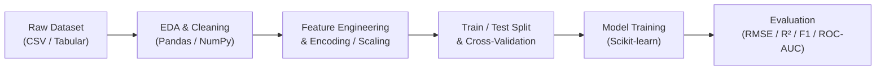

<div align="center">

# 🤖 Python Machine Learning Modeling Suite

### *Tabular Regression & Classification Workflows with Scikit-learn, Pandas & NumPy*

[](https://www.python.org/)
[](https://scikit-learn.org/)
[](https://pandas.pydata.org/)
[](https://jupyter.org/)

</div>

---

## 📌 Overview

A curated collection of hands-on tabular **Machine Learning** projects built with **Python** and **Scikit-learn**, demonstrating the full modeling lifecycle from exploratory data analysis (EDA) and feature preprocessing to model training, hyperparameter tuning, and metric evaluation.

---

## ⚙️ Standard ML Pipeline Workflow



---

## 📂 Projects Included

| Project / Directory | Task Type | Domain |
| :--- | :--- | :--- |
| **`Car_Cost_ML/`** | Regression | Automotive price prediction |
| **`Home_Cost_ML/`** & **`Ai-house-price.ipynb`** | Regression | Real estate & housing price estimation |
| **`Medical_Insurance_ML/`** | Regression | Healthcare insurance cost prediction |
| **`Zara_Sales_ML/`** | Regression / Analytics | Retail & apparel sales modeling |
| **`Plane_ML/`** | Regression / Prediction | Aviation / flight pricing analysis |
| **`Student_Performance_ML/`** | Regression / Classification | Academic performance prediction |
| **`Diabetes_ML/`** | Classification | Clinical diabetes risk prediction |
| **`Heart_Disease_ML/`** | Classification | Cardiovascular disease classification |

---

## 🚀 Getting Started

```bash
git clone https://github.com/blgnr1/python-ml-projects.git
cd python-ml-projects

python -m venv .venv
# Windows: .venv\Scripts\activate  |  Linux/macOS: source .venv/bin/activate
pip install pandas numpy scikit-learn matplotlib seaborn jupyter
jupyter notebook
```

---

<div align="center">
  <sub>Built by <b>Kerem Bilginer</b> · <a href="https://www.linkedin.com/in/kerem-bilginer/">LinkedIn</a> · <a href="https://www.blgnr1.com/">Portfolio</a></sub>
</div>
